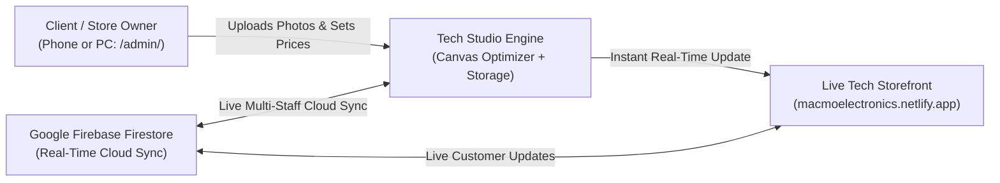

# ⚡ MacMo Electronics — Tech Studio Manager & Deployment Guide

> **Zero Coding Required • Instant Phone Photo Uploads • 1-Click Launch • Drag-and-Drop Netlify Deployment • Ready for Firebase Cloud Auth & Real-Time Sync**

The store owner and staff at **Shop #1 Silverest Complex (Opposite UNILUS)** can now securely log in to the admin portal, add new devices, upload photos directly from their phone camera or computer, edit prices in ZMW, and publish updates live to the storefront in real time!

---

## 🏛️ Architecture & Sync Workflow



---

## ⚡ 1. Quick Start (1-Click Desktop Launcher)

On your computer inside the **`MacMo Electronics`** folder:
1. Double-click **`Launch_MacMo_Store.bat`**.
2. This automatically starts your local web server on port `8089` and opens both:
   - **Storefront**: [http://localhost:8089/](http://localhost:8089/)
   - **Tech Studio Admin**: [http://localhost:8089/admin/](http://localhost:8089/admin/)

---

## 📦 2. New Streamlined Architecture & Layby Services

Following direct client feedback, the website has been streamlined to eliminate bulk and make ordering immediate:

1. **Streamlined Hero with Instant Search**:
   - Customers can immediately type any model into the hero search bar (e.g. *PS5*, *iPhone 15*, *MacBook*) and jump straight to filtered results in under 2 seconds.
2. **Prominent 1-Tap WhatsApp Ordering**:
   - Every product card now features a prominent **"⚡ Order on WhatsApp"** button.
   - Tapping it instantly opens WhatsApp with the exact model name, Kwacha price, and inquiry for pickup at Shop #1 Silverest or Lusaka delivery.
3. **Interactive Layby Services Hub (0% Interest)**:
   - Integrated alongside Trade-In with a sleek switcher:
     - **Tab 1: Phone & Console Trade-In Calculator** (instant trade valuation credit).
     - **Tab 2: Smart Layby Payment Calculator**:
       - Select any product from the store.
       - Select initial deposit (20%, 30%, or 50%).
       - Select duration (1, 2, or 3 months).
       - Transparent breakdown: Deposit due today, remaining balance, and monthly installment with 0% interest guarantee.
       - Button: **"Reserve Device on Layby via WhatsApp"**.
4. **Consolidated Solutions & Perks**:
   - Streamlined into a high-impact 2-card grid:
     - **🎓 UNILUS Campus Priority Drop-Off** (15-min delivery to student hostels).
     - **🏢 Corporate Fleet & Bulk Procurement** (Bulk laptops, iPads, and blackout power stations for institutions).
5. **Customer Praise & Verified Reviews**:
   - Real reviews from students, gamers, and Lusaka business consultants.

---

## 🔐 3. How to Log In to the Admin Portal

1. Open **[http://localhost:8089/admin/](http://localhost:8089/admin/)** (or `yourdomain.com/admin/`).
2. **Current Sign-In Options (Offline / Master Passkey Mode)**:
   - **Email**: `admin@macmo.com`
   - **Password**: `macmo2026`
   - Or tap **"⚡ 1-Tap Quick Owner Access (Offline/Local)"** for instant access without typing!
3. Tap **Sign Out** anytime in the top-right navbar to lock the portal.

---

## 📸 4. How the Client Adds Items & Uploads Photos

1. Once inside the Tech Studio dashboard, click **"+ Add New Tech Device & Photo"**.
2. **Attaching a Photo** (3 Easy Options):
   - **Option A — Upload from Phone Camera or Gallery**:
     - Tap **"Tap to Choose or Take Photo"**.
     - Take a photo with your phone camera or select from your gallery.
     - The built-in **Canvas Optimizer** automatically resizes and compresses high-resolution photos (even 12MP/48MP camera shots) down to lightweight, fast-loading images (~60 KB) so your website remains lightning fast!
   - **Option B — Tech Library**:
     - Select from preloaded high-resolution photos (iPhone 15 Pro Max, PS5, MacBook Air M3, S24 Ultra, EcoFlow, etc.).
   - **Option C — Web Link**:
     - Paste any external image link if preferred.
3. **Fill in Device Details**:
   - **Device Name / Model** (e.g. *Apple iPhone 15 Pro Max (256GB)*)
   - **Brand** (e.g. *Apple*, *Samsung*, *Sony*, *EcoFlow*, *Oraimo*)
   - **Category** (*Smartphones*, *Gaming & PlayStation*, *Laptops & MacBooks*, *iPads & Tablets*, *Audio*, *Wearables*, *Power*, *Accessories*)
   - **Price in ZMW (K)** (e.g. *24999*)
   - **Badge** (e.g. *Flagship*, *Campus Pick*, *Certified Pre-Owned*, *Grade A+*)
   - **Key Specifications** (e.g. *256GB • Titanium • A17 Pro Chip • 12-Month Warranty*)
   - **Stock Status** (*In Stock at Silverest* vs *Sold Out / Order on Request*)
4. Click **"Save & Publish Item"**:
   - The device immediately appears in the Admin Inventory and goes **live on the storefront** with its photo, price, and specs!

---

## ✏️ 5. Everyday Shop Management

* **1-Tap Stock Toggles**: Tap **"Available"** or **"Sold Out"** on any device to update stock status instantly.
* **Editing Prices & Specs**: Click the **"✏️ Edit"** button on any device to adjust its price, specifications, or change its photo.
* **Deleting Discontinued Items**: Click the **"🗑️"** trash icon to remove an item from the catalog.
* **Store Settings**: Switch to the **"Store & Hotlines"** tab to update primary WhatsApp numbers (`+260 972 756 767` / `+260 572 408 101`), opening hours, or campus delivery notices.
* **Backup & Static Export**: Switch to the **"Backup & Firebase"** tab:
  - **Download Catalog JSON Backup**: Saves a clean JSON backup with photos.
  - **Download Updated products-data.js**: Generates an updated JavaScript catalog file ready to replace the file in your project for 100% static hosting without any database!
  - **Upload / Sync Entire Catalog to Google Firebase Cloud**: One-tap sync to cloud Firestore database.

---

## ☁️ 6. How to Connect Google Firebase (Free Real-Time Cloud Sync)

When you are ready to connect Google Firebase for multi-device staff sync:

1. Go to **[console.firebase.google.com](https://console.firebase.google.com/)** and sign in with your Google account.
2. Click **"Add project"** → Name it **`macmo-electronics`** → Click **"Create"**.
3. In the left sidebar:
   - Click **"Authentication"** → Click **"Get started"** → Enable **Email/Password** sign-in method.
   - Click the **"Users"** tab → Click **"Add user"** → Enter the store owner's email (e.g. `owner@macmoelectronics.com`) and password.
4. Click **"Firestore Database"** → Click **"Create database"** → Choose **"Start in test mode"**.
5. Click the **Gear ⚙️ (Project settings)** at the top left → Under **"Your apps"**, click the Web icon **`</>`** to register a web app.
6. Copy the `firebaseConfig` object and paste it into [`firebase-config.js`](file:///C:/Users/cchisala/OneDrive%20-%20aacmining.com.zm/desktop/MacMo%20Electronics/firebase-config.js):
   ```javascript
   window.MACMO_FIREBASE = {
     enabled: true, // <-- Change to true
     config: {
       apiKey: "AIzaSy...",
       authDomain: "macmo-electronics.firebaseapp.com",
       projectId: "macmo-electronics",
       storageBucket: "macmo-electronics.appspot.com",
       messagingSenderId: "...",
       appId: "..."
     }
   };
   ```
7. Once `enabled: true` is saved, the Admin Portal and Storefront automatically synchronize across all phones and computers via Google Cloud Firestore!
8. Open the Admin portal, go to **Backup & Firebase**, and tap **"Upload / Sync Entire Catalog to Google Firebase Cloud"** to push all initial devices in one click!

---

## 🚀 7. How to Deploy Live to Netlify (Free Hosting in 10 Seconds)

1. Open **[netlify.com](https://www.netlify.com/)** and log in.
2. Drag and drop the folder **`MacMo Electronics`** directly into the Netlify Sites dashboard.
3. Your tech store is live on the internet with a free SSL certificate!
4. To add a custom domain (e.g. `macmoelectronics.com` or `macmo.co.zm`):
   - Go to **Site settings → Domain management → Add a custom domain**.
   - Follow Netlify's DNS guide to point your domain name.

---

## 💬 8. Ready-to-Send Client Reply (Addressing Their Feedback)

You can copy and send this message directly to your client:

---

**Dear MacMo Electronics Team,**

Thank you very much for the fantastic feedback! We have implemented all your recommendations to make the website clean, lightning fast, and conversion-focused:

### 1. **Streamlined & De-Cluttered ("Less Bulky")**:
* We removed the heavy visual clutter so customers immediately see what they came for.
* Added an **Instant Quick-Search Bar** right in the hero banner. A customer can type *"PS5"* or *"iPhone"* and see matching devices instantly.
* Merged secondary sections into clean, compact units so the page feels fast and effortless to navigate on phone or laptop.

### 2. **Instant 1-Tap WhatsApp Ordering**:
* Every single product card now has a prominent **"⚡ Order on WhatsApp"** button.
* When tapped, it automatically launches WhatsApp addressed to your official numbers (`+260 972 756 767` / `+260 572 408 101`) pre-loaded with the exact product name, price in Kwacha, and store pickup or Lusaka delivery inquiry!

### 3. **Brand New Layby Services & Calculator (0% Interest)**:
* As requested, we integrated **Layby Services** directly into the Trade-In Hub with a clean toggle:
  * **Phone & Console Trade-In** (Instant trade credit calculation).
  * **0% Interest Layby Plan**: Customers can select any device, choose their deposit (20%, 30%, 50%), choose their duration (1–3 months), and see their exact monthly installment with a direct **"Reserve Device on Layby via WhatsApp"** button.
* Every product card also displays a friendly badge showing how much deposit is needed to lock it down on Layby!

### 4. **Preserved Bulk Procurement & Reviews**:
* We kept the **Corporate Fleet & Bulk Procurement** section and **Customer Testimonials** in a sleek, elegant layout that highlights your trustworthiness across Lusaka and UNILUS.

Please check the live link and let us know your thoughts:
👉 **[https://macmoelectronics.netlify.app/](https://macmoelectronics.netlify.app/)**

Best regards,  
**Chris Chisala | ChrisTech**
